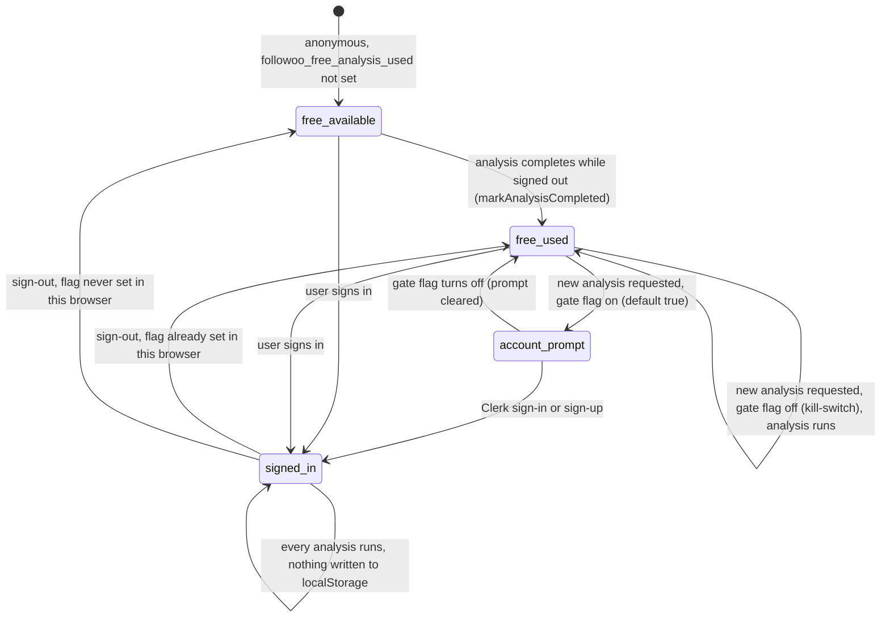
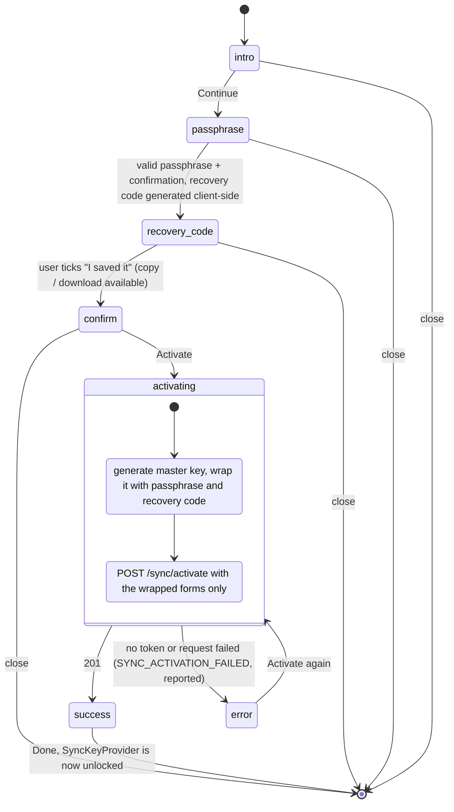
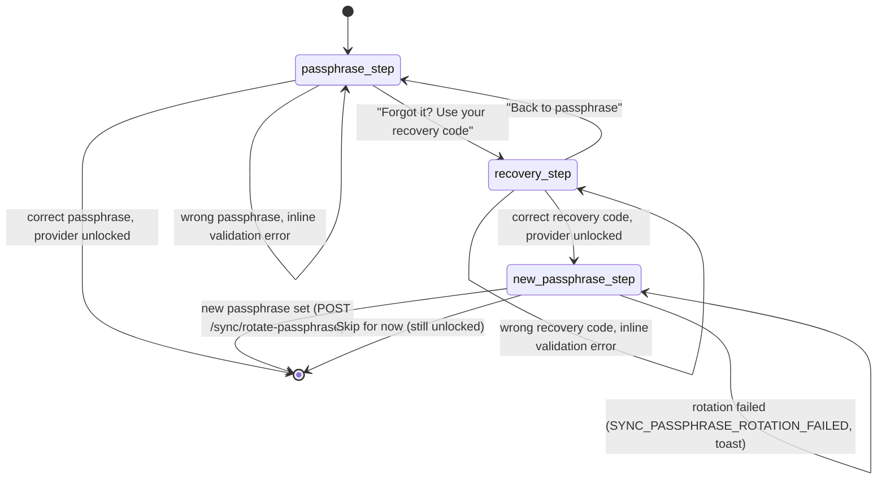

# Followoo architecture

> Keep these diagrams current as part of the `impact-assessment` sweep for every impactful push that changes the architecture, a data flow or one of the state machines below. They live here, in the repo, so the agent that makes the change updates them in the same push. Nothing about them needs to happen on Notion any more.
>
> CI checks that every `mermaid` block in this file parses (`scripts/validate-mermaid.mjs`, job `docs-mermaid` in `.github/workflows/ci.yml`). It checks syntax only: whether a diagram is still *true* is the author's job.

Each diagram names the files it describes. When one of those files changes behavior, re-read the diagram.

## 1. System overview

Components and data flow across the browser, hosting, managed services, backend, database and CI.

The privacy boundary is the point of the picture: the Instagram export ZIP is parsed and analyzed only in the browser. What leaves the device is a Clerk JWT, anonymous usage events, already-wrapped keys and already-encrypted snapshots. Never relationship data in clear.

```mermaid
flowchart TB
    subgraph Browser["Browser - client-side, privacy-first core"]
        SPA["React 19 + Vite 7 SPA<br/>routes: / /get-started /instructions-to-start<br/>/results /history /updates /support /privacy-and-policy /terms-and-conditions"]
        Parse["Instagram export parsing - JSZip<br/>(src/features/instagram-export)<br/>never leaves the device"]
        Analysis["Relationship analysis<br/>followers, following, mutuals, unfollowers, blocked, personas<br/>(src/features/relationship)"]
        Gate["useFreeAnalysisGate<br/>localStorage followoo_free_analysis_used"]
        SyncProvider["SyncKeyProvider<br/>checking / inactive / locked / unlocked / unavailable"]
        Crypto["WebCrypto (src/features/sync/crypto)<br/>master key, wrap with passphrase + recovery code,<br/>encrypt / decrypt snapshots"]
        History["History (src/features/history)<br/>useAutoSaveSnapshot, useHistorySnapshots, useOpenSnapshot"]
        ClerkSDK["@clerk/react<br/>Google OAuth + email/password"]
        PostHogJS["posthog-js<br/>useFeatureFlag, usePostHogIdentity"]
        SentryJS["@sentry/react<br/>scrubSentryEvent (src/errors/sentryInit.ts)"]
        EmailJSClient["@emailjs/browser<br/>support form only"]
    end

    subgraph Vercel["Vercel"]
        Hosting["Static hosting + CDN<br/>production = main, preview = preview branch"]
        Prerender["Prerendered public pages for SEO<br/>(scripts/prerender-static.mjs)"]
        PWA["PWA manifest + service worker<br/>(vite-plugin-pwa)"]
    end

    subgraph ClerkCloud["Clerk - managed auth"]
        ClerkAuth["Sign-in / sign-up, session JWTs"]
        JWKS["JWKS<br/>production: clerk.followoo.app<br/>preview/local: development instance"]
    end

    subgraph Render["Render - FastAPI backend (followoo-api / followoo-api-preview)"]
        StartSh["backend/start.sh<br/>alembic upgrade head, then uvicorn"]
        API["app.main: CORS, slowapi rate limits, /health"]
        AuthDep["app.auth.clerk.get_current_clerk_user_id<br/>FastAPI dependency: RS256 via JWKS, azp check"]
        UsersMod["users: GET /users/me, POST /usage-events"]
        SyncMod["sync: POST /sync/activate,<br/>GET /sync/credentials, POST /sync/rotate-passphrase"]
        SnapshotsMod["snapshots: POST/GET /snapshots,<br/>GET/DELETE /snapshots/{id}"]
        UpdatesMod["updates: GET /updates - public, no auth"]
        SentryPy["sentry_sdk with scrubbing<br/>(app/core/sentry.py)"]
    end

    subgraph Neon["Neon Postgres (followoo-database)"]
        Tables["tables: updates, users, subscriptions, usage_events,<br/>sync_keys (wrapped keys only),<br/>analysis_snapshots (ciphertext + iv only)"]
        MainDB["main branch - production"]
        PreviewDB["preview-backend branch - staging"]
    end

    subgraph PostHogCloud["PostHog"]
        Flags["Feature flags<br/>followoo-account-gate-enabled (default true)<br/>followoo-encrypted-history-sync-enabled (default false)"]
        Events["Product analytics - no relationship data"]
    end

    SentryCloud["Sentry"]
    EmailJS["EmailJS"]

    subgraph CI["GitHub Actions"]
        Verify["ci.yml: verify, backend-verify, docs-mermaid"]
        ChromaticJob["ci.yml: chromatic (required on main)"]
        EnvCheck["ci.yml: deploy-env-check"]
        Smoke["ci.yml: smoke-test"]
        MigrationsJob["migrations.yml: dry-run on a temporary Neon branch,<br/>apply-preview to preview-backend"]
        Marketing["regenerate-marketing-assets.yml<br/>opens a review PR into preview"]
    end

    SPA -- "user drops the ZIP, no network call" --> Parse --> Analysis --> SPA
    SPA --> Gate
    SPA <--> ClerkSDK <--> ClerkAuth
    SPA -- "Bearer JWT on authenticated requests" --> API
    SPA -- "public changelog" --> UpdatesMod
    Analysis -- "completed analysis" --> History
    History --> SyncProvider --> Crypto
    SyncProvider -- "wrapped keys only" --> SyncMod
    History -- "encrypted blob + iv only, the backend cannot read it" --> SnapshotsMod
    API --> AuthDep
    AuthDep -. "fetches and caches signing keys" .-> JWKS
    AuthDep --> UsersMod & SyncMod & SnapshotsMod
    API --> UpdatesMod
    UsersMod & SyncMod & SnapshotsMod & UpdatesMod --> Tables
    Tables --- MainDB
    Tables --- PreviewDB
    StartSh -. "migrates the service's own branch on boot" .-> Tables
    SPA --> PostHogJS --> Flags & Events
    SPA --> SentryJS --> SentryCloud
    SentryPy --> SentryCloud
    SPA --> EmailJSClient --> EmailJS
    Hosting -. serves .-> SPA
    Prerender -.- Hosting
    PWA -.- Hosting
    CI -. "checks env var names, smoke-tests after deploy" .-> Vercel
    CI -. "smoke-tests /health, checks env var names" .-> Render
    MigrationsJob -. "dry-run + apply" .-> Neon
```



Things the diagram encodes on purpose:

- Vercel and Render deploy on their own from the GitHub push (Vercel and Render Git integrations). CI does not deploy; it checks and smoke-tests (see `docs/CI.md`).
- Migrations reach production only through `backend/start.sh` on `followoo-api` boot. CI applies them to `preview-backend` only.
- The backend has no auth middleware: each protected route declares `Depends(get_current_clerk_user_id)`. `GET /updates` and `/health` are the only unauthenticated routes.

## 2. Encrypted history key state (`SyncKeyProvider`)

Source: `src/providers/SyncKeyProvider.tsx`. The state lives in React memory only: a reload or a new tab mounts the provider again at `checking`, and the master key is never persisted.

```mermaid
stateDiagram-v2
    [*] --> checking: provider mounts
    checking --> inactive: Clerk loaded, signed out OR sync flag off
    checking --> inactive: GET /sync/credentials says active false
    checking --> locked: GET /sync/credentials says active true
    checking --> unavailable: no Clerk token OR credentials fetch failed (AppError, reported)
    inactive --> unlocked: SyncActivationWizard success, setUnlockedAfterActivation
    locked --> : -->
    locked --> unlocked: unlockWithRecoveryCode OK (unlockedVia = recovery)
    locked --> locked: wrong passphrase or recovery code (MasterKeyUnwrapError, validation only)
    unlocked --> unlocked: setNewPassphrase after a recovery unlock (POST /sync/rotate-passphrase)
    inactive --> checking: signed in with the sync flag on (re-check)
    locked --> inactive: sign-out or flag off
    unlocked --> inactive: sign-out or flag off, master key dropped
    unavailable --> inactive: sign-out or flag off
    unavailable --> checking: session token changes (re-check)
    checking --> [*]: reload or new tab starts over
```

Notes:

- Activation goes straight from `inactive` to `unlocked`. The key was just generated in this session, so the user is never asked to unlock it.
- Within a session, `unlocked` is left only by signing out or by the flag turning off, which lands in `inactive` and drops the key. There is no explicit "lock" action.
- A wrong passphrase or recovery code is expected UI validation, never an `AppError`, per rule 3 in `AGENTS.md`.

## 3. Free analysis gate (`useFreeAnalysisGate`)

Sources: `src/features/instagram-export/hooks/useFreeAnalysisGate.ts`, called from `useInstagramExportAnalysis.ts`; the prompt renders in `InstagramExportUploadExperience.tsx`.

The gate is a soft funnel signal stored in `localStorage`, not a security boundary. The demo analysis bypasses it entirely.



Notes:

- `requestAnalysis()` blocks only when all three hold: gate flag on, signed out, free analysis already used. Otherwise it returns `true`.
- If `localStorage` is unavailable, the flag is never written, so the gate never triggers in that browser. Accepted: the hard boundary is the backend JWT check.

## 4. Encrypted history activation wizard (`SyncActivationWizard`)

Sources: `src/features/sync/components/SyncActivationWizard.tsx` (steps) and `src/features/sync/hooks/useSyncActivation.ts` (the `activate` side effect).



The modal cannot be closed while `activating`. A closed wizard keeps nothing: the passphrase and recovery code exist only in component state.

## 5. Unlock wizard (`SyncUnlockWizard`)

Source: `src/features/sync/components/SyncUnlockWizard.tsx`. Opened from a `locked` state (for example `HistorySavePrompt`'s "Unlock and save").


